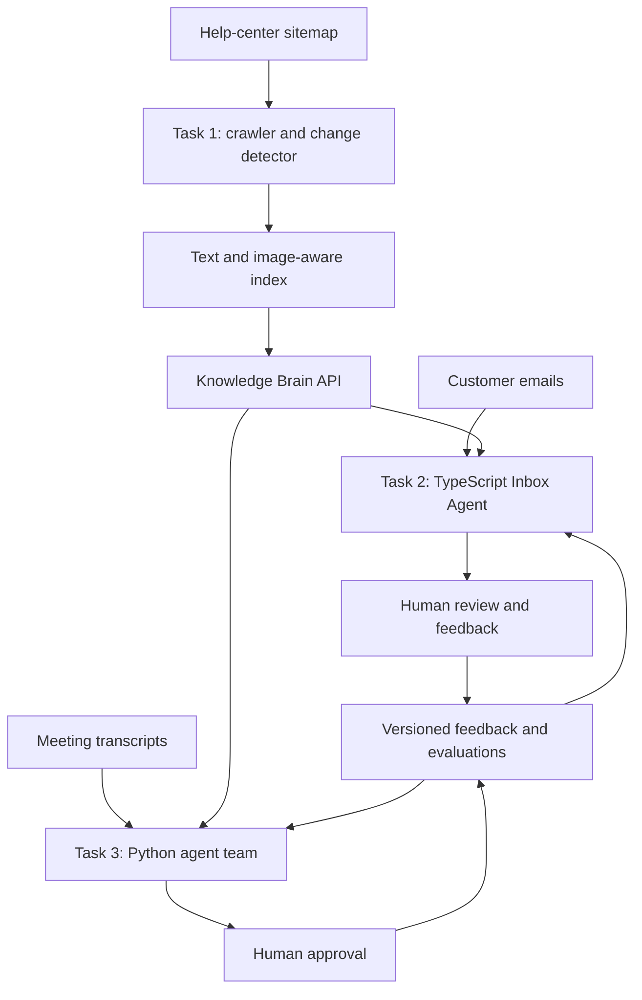

# Design — AI Tech Consultant

## 1. Problem

Small software businesses need to respond accurately to customer questions, understand requests hidden in email threads, and turn vague meetings into precise, priced work. These activities consume time even when coding itself is fast.

This system connects three workflows around one shared source of product knowledge. It is designed for configurable use by different software or service businesses rather than hard-coded to one company.

## 2. Product decisions

### Task 1: Knowledge Brain (Python)

- Read the public help-center sitemap and process pages in bounded batches.
- Persist crawl progress so interrupted runs can resume.
- Extract article text and preserve image references; generate image descriptions where supported.
- Store canonical URL, title, content hash, crawl timestamp, and deletion state.
- Retrieve relevant passages and return source URLs with each answer.
- Run a daily sitemap diff and remove deleted pages from active retrieval.
- Create a human-review task when confidence or evidence is insufficient.

### Task 2: Inbox Agent (TypeScript)

- Classify email intent: how-to, project request, refund, complaint, quote, follow-up, or other.
- Call Task 1's documented API for product facts.
- Return schema-validated drafts with evidence, confidence, and a recommended action.
- Store draft, sent reply, human edits, category, and prompt/model version.
- Start with human approval required. Autonomous sending is only a later, measured capability.

### Task 3: Meeting to Scope of Work (Python)

- Transcript Analyst: extracts requirements, decisions, constraints, open questions, and stakeholders.
- Knowledge Checker: calls Task 1 to find existing product settings or documented capabilities.
- Estimator: creates task-level hour estimates with assumptions and uncertainty.
- Proposal Writer: assembles scope, exclusions, timeline assumptions, and commercial proposal.
- Change Analyst: compares later transcripts against the approved baseline and flags new/out-of-scope requests.
- Human approval is required before any client-facing proposal is sent.

## 3. System boundaries

Task 1 owns crawling, indexing, retrieval, citations, and the knowledge API. Tasks 2 and 3 are API clients. Each task owns its prompts, schemas, logs, and evaluations.

## 4. Reliability and safety

- Treat retrieved web pages and email contents as untrusted data, never as system instructions.
- Validate structured model output against schemas; retry bounded failures.
- Keep model/API keys in environment variables.
- Log request IDs, model and prompt versions, latency, token usage, and errors without exposing secrets.
- Require human approval for sensitive email categories and all proposals.
- Keep a versioned audit trail for feedback and prompt changes; allow rollback.
- Do not claim quality improvements without evaluation results.

## 5. Trade-offs and open decisions

The vector database, embedding model, image-captioning approach, and Claude model tier should be selected using measured quality, cost, and latency on representative evaluations. Start with a simple retrieval design and avoid adding a knowledge graph unless tests show a clear benefit.

## 6. Diagram

## 7. Next steps

Implement the Knowledge Brain first, document and test its API, then build the TypeScript Inbox Agent and the meeting-to-scope workflow against that API. Replace assumptions with measured results in EVALS.md.